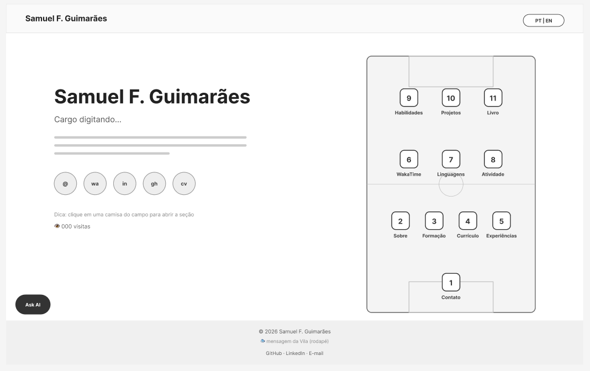
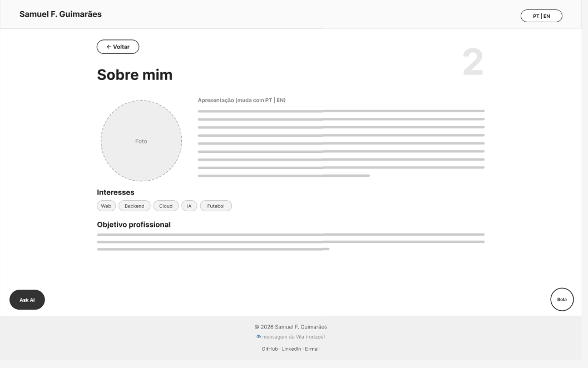
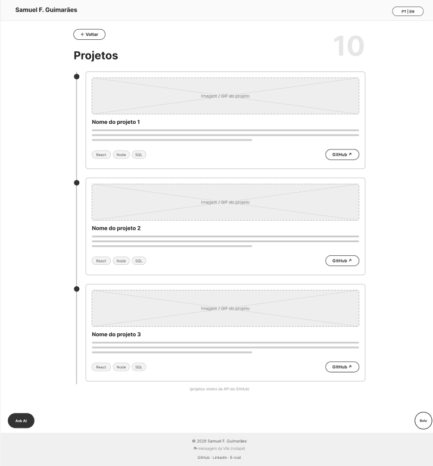
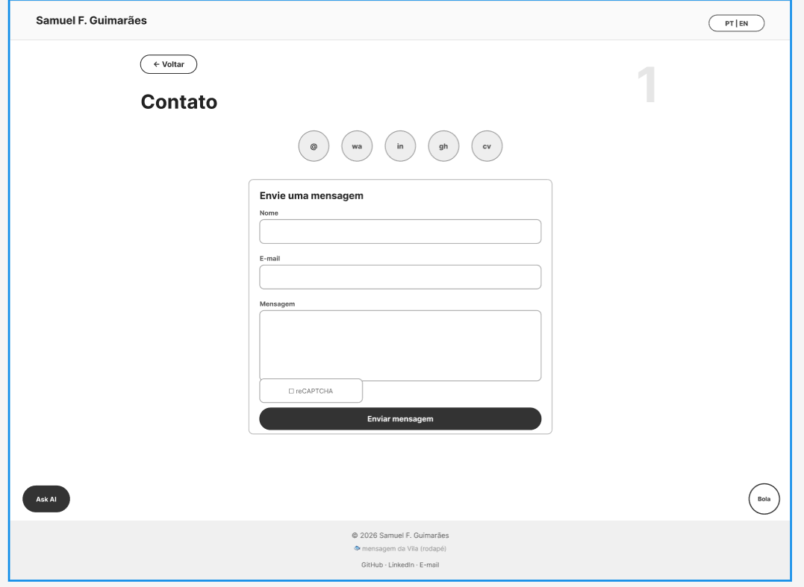
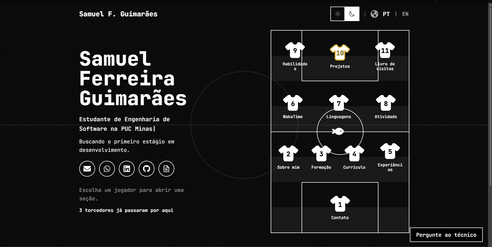
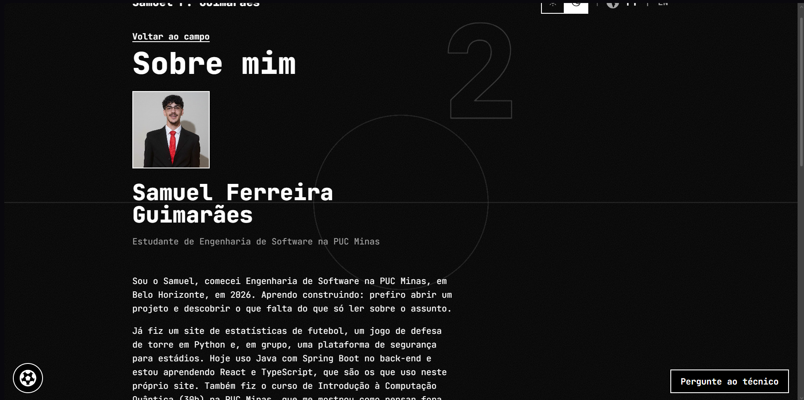
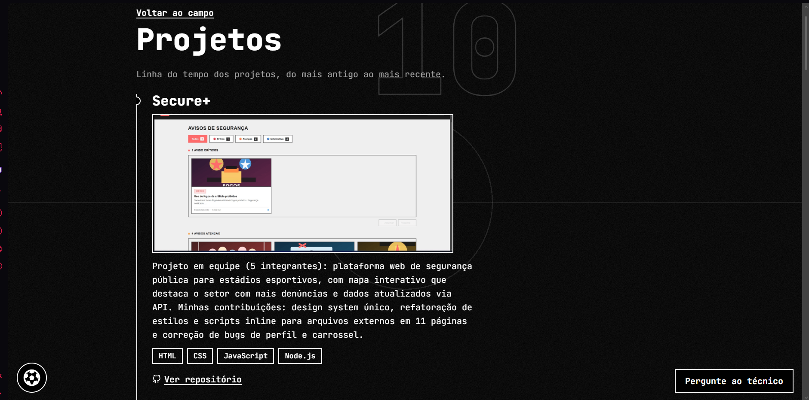
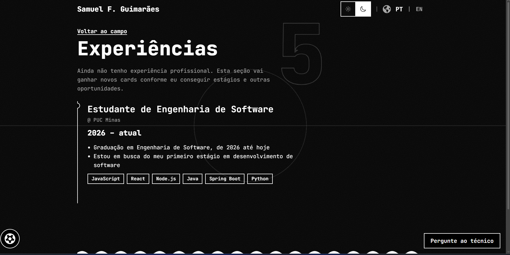
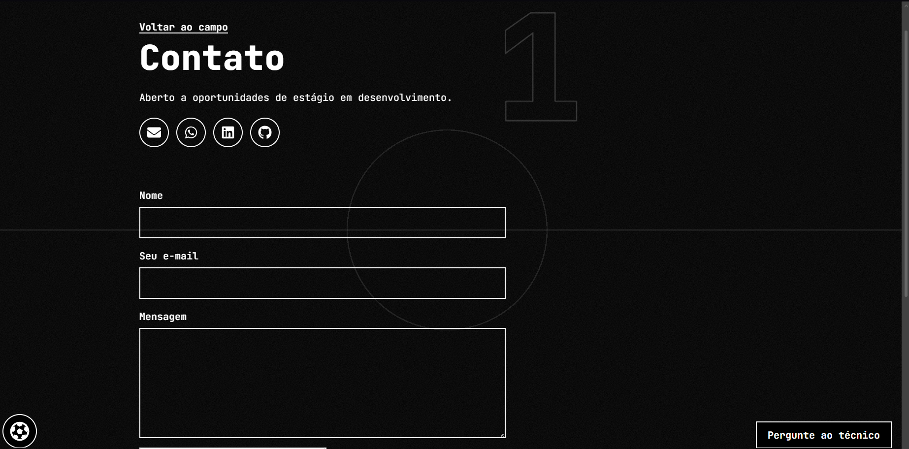
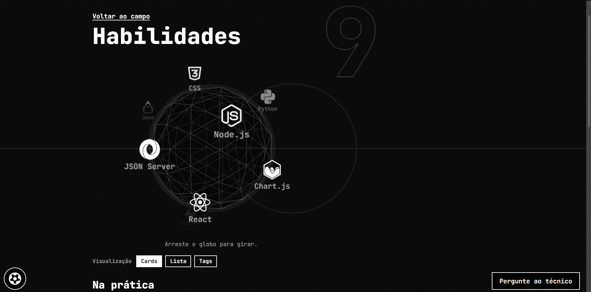

# 🏷️ Portfólio de Samuel Ferreira Guimarães 👨‍💻

> [!NOTE]
> Portfólio profissional com tema do Santos Futebol Clube. A navegação é uma prancheta tática: cada jogador em campo abre uma seção do site.

<table>
  <tr>
    <td width="800px">
      <div align="justify">
        Este é o meu portfólio, feito para o <b>Laboratório 01</b> de Desenvolvimento e Integração de Aplicações Web (Engenharia de Software, PUC Minas). Ele reúne quem eu sou, minha formação, os projetos que já fiz, minhas habilidades e as formas de entrar em contato, em português e em inglês. Além das seções pedidas no laboratório, o site tem um back-end em Spring Boot que busca dados do meu GitHub e do WakaTime, um livro de visitas e um chatbot que responde perguntas sobre o portfólio.
      </div>
    </td>
  </tr>
</table>

---

## 🚧 Status do Projeto

     

---

## 📚 Índice
- [Links Úteis](#-links-úteis)
- [Sobre o Projeto](#-sobre-o-projeto)
- [Funcionalidades Principais](#-funcionalidades-principais)
- [Tecnologias Utilizadas](#-tecnologias-utilizadas)
- [Arquitetura](#-arquitetura)
- [Instalação e Execução](#-instalação-e-execução)
  - [Pré-requisitos](#pré-requisitos)
  - [Variáveis de Ambiente](#-variáveis-de-ambiente)
  - [Instalação de Dependências](#-instalação-de-dependências)
  - [Como Executar a Aplicação](#-como-executar-a-aplicação)
- [Deploy](#-deploy)
- [Estrutura de Pastas](#-estrutura-de-pastas)
- [Demonstração](#-demonstração)
- [Testes](#-testes)
- [Documentações utilizadas](#-documentações-utilizadas)
- [Autores](#-autores)
- [Contribuição](#-contribuição)
- [Agradecimentos](#-agradecimentos)
- [Licença](#-licença)

---

## 🔗 Links Úteis
* 🌐 **Site publicado (Vercel):** [Acesse o portfólio](https://samuel-ferreira-portifolio.vercel.app/)
* ⚙️ **API (Render):** [Verificar status](https://samuelferreira-portifolio.onrender.com/api/health)
* **Protótipos (Figma):** [Ver wireframes](https://www.figma.com/design/E6U21GU6kyIapfEtKsY3Gx/Wireframes---Portf%C3%B3lio-Samuel?node-id=2-2&p=f&t=SBen83Wc1MZ4PHU6-0)
* **Repositório:** [github.com/SamuelFerr0/SamuelFerreira_Portifolio](https://github.com/SamuelFerr0/SamuelFerreira_Portifolio)

---

## 📝 Sobre o Projeto

O laboratório pedia um site de portfólio com quatro seções (Sobre Mim, Projetos, Experiências e Contato), responsivo, hospedado na nuvem e com um README completo. Eu segui essa base e dei ao site a identidade visual do Santos. Em vez de um menu comum, a navegação é uma prancheta tática com os jogadores em campo, e cada camisa leva a uma seção.

Sou estudante de Engenharia de Software na PUC Minas (2º período, curso de fevereiro de 2026 a dezembro de 2030) e estou atrás do meu primeiro estágio em desenvolvimento. O portfólio existe para mostrar o que já construí e facilitar o contato de quem quiser conversar.

Ainda não tenho experiência profissional, e o site diz isso abertamente: a seção de Experiências mostra a graduação e vai ganhar novos cards quando eu conseguir estágios ou outras oportunidades.

---

## ✨ Funcionalidades Principais

**Exigidas pelo laboratório**

- **Sobre Mim** em português e inglês, com botão para trocar o idioma.
- **Projetos** em linha do tempo, do mais antigo ao mais recente, cada um com descrição, tecnologias, link do repositório no GitHub e imagem.
- **Experiências** com instituição, cargo, período e descrição.
- **Contato** com ícones de e-mail, WhatsApp e LinkedIn e um formulário (nome, e-mail e mensagem) que envia e-mail pelo EmailJS, com validação e reCAPTCHA.
- Design responsivo, tema claro e escuro.

**Extras que acrescentei**

- Habilidades em um globo 3D interativo.
- Formação e currículo em PDF (português e inglês) visualizável no próprio site.
- Linguagens e atividade do GitHub e estatísticas do WakaTime, vindas da API em Spring Boot.
- Livro de visitas e contador de visitas, guardados no Supabase.
- Chatbot ("o técnico") que só responde com base no conteúdo do portfólio.
- Abertura animada na primeira visita.

---

## 🛠 Tecnologias Utilizadas

### 💻 Front-end

* **Biblioteca:** React 19
* **Linguagem:** TypeScript
* **Build:** Vite
* **Traduções:** i18next e react-i18next
* **3D:** Three.js com React Three Fiber e Drei
* **Formulário de contato:** EmailJS e Google reCAPTCHA
* **Outros:** react-pdf, react-type-animation, react-icons, country-flag-icons, fonte JetBrains Mono

### 🖥️ Back-end

* **Linguagem/Runtime:** Java 25
* **Framework:** Spring Boot 4.1.1 (Spring Web MVC, Validation, Cache, JDBC)
* **Cache:** Caffeine (10 minutos)
* **Banco de Dados:** H2 em memória no desenvolvimento e PostgreSQL (Supabase) em produção
* **Integrações:** API do GitHub, API do WakaTime (OAuth) e uma API de IA compatível com OpenAI (Gemini) para o chatbot

### ⚙️ Infraestrutura & DevOps

* **Containerização:** Docker (`backend/Dockerfile`)
* **Cloud:** Vercel (front-end), Render (back-end em container) e Supabase (banco)
* **CI/CD:** GitHub Actions, com um workflow que chama a API a cada 12 horas para o Supabase não pausar por inatividade
* **Protótipos:** Figma

### 📦 Dependências e Bibliotecas

A lista completa, com versões, está em `frontend/package.json` e `backend/pom.xml`. As principais:

**Front-end (npm)**

| Pacote | Versão | Uso |
| :--- | :--- | :--- |
| `react`, `react-dom` | ^19.2 | Interface |
| `vite`, `@vitejs/plugin-react` | ^8.3 / ^6.1 | Build e servidor de desenvolvimento |
| `typescript` | ~6.0 | Tipagem |
| `i18next`, `react-i18next` | ^26 / ^17 | Português e inglês |
| `three`, `@react-three/fiber`, `@react-three/drei` | ^0.186 / ^9.8 / ^10.7 | Globo 3D de habilidades |
| `@emailjs/browser` | ^5.0 | Envio do formulário de contato |
| `react-pdf` | ^10.5 | Visualização do currículo em PDF |
| `react-type-animation`, `react-icons`, `country-flag-icons` | ^3.2 / ^5.7 / ^1.6 | Animação, ícones e bandeiras |
| `eslint`, `typescript-eslint` | ^9.33 / ^8.40 | Lint |

**Back-end (Maven)**

| Dependência | Uso |
| :--- | :--- |
| `spring-boot-starter-webmvc` | API REST |
| `spring-boot-starter-validation` | Validação das requisições |
| `spring-boot-starter-cache` e `caffeine` | Cache de 10 minutos |
| `spring-boot-starter-jdbc` | Acesso ao banco |
| `h2` e `postgresql` | Banco em memória (dev) e PostgreSQL (produção) |

---

## 🏗 Arquitetura

O projeto é um monorepo com duas aplicações separadas. O front-end é um site estático (SPA em React) que roda inteiro no navegador. O back-end é uma API REST em Spring Boot que existe para guardar as chaves de serviços externos fora do front e para persistir o livro e o contador de visitas.

```
Navegador (React)
   |-- EmailJS ---------------> envio do formulário de contato
   |-- reCAPTCHA -------------> validação do formulário
   |
   '-- API Spring Boot (/api/*)
         |-- GitHub API ------> repositórios, linguagens, atividade
         |-- WakaTime API ----> horas de código e linguagens
         |-- API de IA -------> chatbot
         '-- PostgreSQL ------> livro e contador de visitas (Supabase)
```

Algumas decisões:

- **Dados de projetos, experiências e habilidades ficam em arquivos do front** (`frontend/src/data`), então editar o conteúdo não exige mexer nos componentes.
- **Textos em PT e EN ficam em um só lugar** (`frontend/src/i18n.ts`).
- **A API é opcional para o front.** Se `VITE_API_URL` estiver vazia, o front não faz chamadas ao back-end: o chatbot não aparece e os dados do GitHub e o contador de visitas ficam desativados. O resto do site continua funcionando.
- **O back-end usa cache de 10 minutos** nas chamadas do GitHub e do WakaTime para não estourar limite de requisições, e tem um limitador de taxa nas rotas de escrita e do chatbot.
- **O chatbot é limitado ao portfólio.** O prompt (`backend/src/main/resources/assistente.md`) manda responder só com os fatos de `perfil.md` e recusar o resto.

**Rotas da API**

| Método | Rota | Descrição |
| :--- | :--- | :--- |
| GET | `/api/health` | Verifica se a API está no ar |
| GET / POST | `/api/visitas` | Lê e incrementa o contador de visitas |
| GET / POST | `/api/livro` | Lista e cria mensagens do livro de visitas |
| POST | `/api/ask` | Pergunta ao chatbot |
| GET | `/api/codando` | Status "codando agora" |
| GET | `/api/wakatime/stats` e `/api/wakatime/stats/{range}` | Estatísticas do WakaTime |
| GET | `/api/github`, `/api/github/linguagens`, `/api/github/atividade`, `/api/github/perfil` | Dados do GitHub |

---

## 🔧 Instalação e Execução

### Pré-requisitos

* **Node.js:** 22 ou superior (front-end)
* **Java JDK:** 25 (back-end). O Maven Wrapper já vem no repositório, não precisa instalar o Maven.
* **npm**
* **Docker** (opcional, só se quiser rodar o back-end em container)

---

### 🔑 Variáveis de Ambiente

#### Front-end

Copie `frontend/.env.example` para `frontend/.env` e preencha.

| Variável | Descrição |
| :--- | :--- |
| `VITE_EMAILJS_SERVICE_ID` | Service ID do EmailJS |
| `VITE_EMAILJS_TEMPLATE_ID_FOR_ME` | Template do e-mail que chega para mim |
| `VITE_EMAILJS_TEMPLATE_ID_FOR_SENDER` | Template da confirmação enviada a quem preencheu o formulário |
| `VITE_EMAILJS_PUBLIC_KEY` | Chave pública do EmailJS |
| `VITE_RECAPTCHA_SITE_KEY` | Chave do site do reCAPTCHA |
| `VITE_API_URL` | Endereço do back-end (ex.: `http://localhost:8080`). Vazio desativa as chamadas ao back-end (chatbot, contador de visitas e dados do GitHub) |

#### Back-end

Todas têm valor padrão ou são opcionais, então a API sobe sem nenhuma. O que depende de chave fica indisponível enquanto ela não for configurada.

| Variável | Descrição | Padrão |
| :--- | :--- | :--- |
| `PORT` | Porta da API | `8080` |
| `CORS_ORIGINS` | Endereços do front liberados | `http://localhost:5173` |
| `GITHUB_USERNAME` | Usuário do GitHub exibido | `SamuelFerr0` |
| `GITHUB_TOKEN` | Token para aumentar o limite da API do GitHub | vazio |
| `GITHUB_HIDDEN_REPOS` | Repositórios que não devem aparecer | vazio |
| `WAKATIME_APP_ID`, `WAKATIME_APP_SECRET` | Credenciais do app OAuth no WakaTime | vazio |
| `WAKATIME_ACCESS_TOKEN`, `WAKATIME_REFRESH_TOKEN` | Tokens gerados pelo script de OAuth | vazio |
| `WAKATIME_REDIRECT_URI` | Redirect cadastrado no app do WakaTime | `http://localhost:8787/callback` |
| `WAKATIME_TIMEZONE` | Fuso usado nas estatísticas | `America/Sao_Paulo` |
| `WAKATIME_DEFAULT_RANGE` | Período padrão das estatísticas | `all_time` |
| `WAKATIME_HIDDEN_LANGUAGES`, `WAKATIME_PROFILE_URL`, `WAKATIME_PROJETOS_PUBLICOS` | Ajustes opcionais do WakaTime | vazio |
| `ASK_API_KEY` (ou `GEMINI_API_KEY`) | Chave da API de IA do chatbot | vazio |
| `ASK_API_URL`, `ASK_MODEL` | Endereço e modelo da API de IA | Gemini (endpoint compatível com OpenAI) |
| `DB_URL`, `DB_USER`, `DB_PASSWORD` | Banco do livro e do contador | H2 em memória |

#### Token do WakaTime

1. Crie um app em wakatime.com/apps com redirect `http://localhost:8787/callback` e os escopos `read_stats`, `read_summaries` e `read_heartbeats`.
2. Com `WAKATIME_APP_ID` e `WAKATIME_APP_SECRET` definidos no terminal, rode `java scripts/WakaTimeOAuth.java` e autorize no navegador.
3. Copie o access token e o refresh token para as variáveis do back-end.

> [!WARNING]
> Nunca faça commit de arquivos `.env` nem dos tokens. O `.gitignore` do front já ignora o `.env`.

---

### 📦 Instalação de Dependências

```bash
git clone https://github.com/SamuelFerr0/SamuelFerreira_Portifolio.git
cd SamuelFerreira_Portifolio
```

**Front-end**

```bash
cd frontend
cp .env.example .env
npm install
```

**Back-end**

O Maven Wrapper baixa as dependências na primeira execução, não há passo extra.

---

### ⚡ Como Executar a Aplicação

Use dois terminais.

#### Terminal 1: Back-end (Spring Boot)

```bash
cd backend
./mvnw spring-boot:run
```

No Windows: `mvnw.cmd spring-boot:run`. A API sobe em **http://localhost:8080**. Sem as chaves de GitHub, WakaTime e IA, essas partes respondem com erro, mas o resto funciona. Localmente o banco é H2 em memória, então o livro e o contador zeram a cada reinício.

#### Terminal 2: Front-end (React, Vite)

```bash
cd frontend
npm run dev
```

O site abre em **http://localhost:5173**. Lembre de colocar `VITE_API_URL=http://localhost:8080` no `.env` se quiser ver as seções que dependem da API.

#### Back-end em Docker (opcional)

```bash
cd backend
docker build -t portfolio-api .
docker run -p 8080:8080 portfolio-api
```

Passe as variáveis com `-e NOME=valor`.

---

## 🚀 Deploy

O front-end está na **Vercel** e o back-end no **Render**, no plano gratuito.

1. **Front-end:** site estático. Comando de build `npm run build`, pasta de publicação `dist`, diretório raiz `frontend`. As variáveis `VITE_*` são configuradas no painel da Vercel e entram no build.
2. **Back-end:** serviço web usando o `backend/Dockerfile` (build com Maven e Java 25). A variável `CORS_ORIGINS` precisa ter o endereço do front publicado.
3. **Banco:** projeto no Supabase. Rode os scripts de `supabase/` (`contador_visitas.sql` e `livro_visitas.sql`) e aponte `DB_URL`, `DB_USER` e `DB_PASSWORD` para ele.
4. **Workflow de ping:** em Settings > Secrets and variables > Actions > Variables do repositório, crie `API_URL` com o endereço do back-end. O workflow `keep-supabase-awake` chama `/api/visitas` a cada 12 horas.

> [!NOTE]
> No plano gratuito do Render o back-end dorme depois de um tempo sem uso, então a primeira requisição pode demorar. O front chama `/api/health` ao carregar justamente para acordar a API cedo.

**Sites publicados:**

- Vercel (site): https://samuel-ferreira-portifolio.vercel.app/
- Render (API): https://samuelferreira-portifolio.onrender.com

---

## 📂 Estrutura de Pastas

```
.
├── .github/workflows/        # ping periódico para o Supabase não pausar
├── backend/
│   ├── Dockerfile
│   ├── mvnw, mvnw.cmd        # Maven Wrapper
│   ├── pom.xml
│   └── src/
│       ├── main/java/com/samuel/portfolio/
│       │   ├── config/       # CORS
│       │   ├── controller/   # rotas /api/*
│       │   ├── dto/          # objetos de requisição
│       │   ├── service/      # GitHub, WakaTime, chatbot, livro e visitas
│       │   ├── util/         # limitador de taxa
│       │   └── PortfolioApplication.java
│       ├── main/resources/   # application.properties, schema.sql, perfil.md, assistente.md
│       └── test/java/
├── docs/img/                 # wireframes e capturas de tela usados no README
├── frontend/
│   ├── .env.example
│   ├── index.html
│   ├── package.json
│   ├── vite.config.ts
│   ├── public/               # currículos em PDF, favicon e imagens dos projetos
│   └── src/
│       ├── components/       # seções e componentes da interface
│       ├── config/           # chaves e endereços lidos do ambiente
│       ├── data/             # projetos, experiências, habilidades, formação e links
│       ├── lib/              # acesso à API, GitHub, WakaTime, e-mail e chatbot
│       ├── theme/            # tema claro e escuro
│       ├── i18n.ts           # textos em português e inglês
│       ├── index.css         # estilos
│       └── main.tsx
├── scripts/
│   └── WakaTimeOAuth.java    # gera os tokens do WakaTime
├── supabase/                 # scripts SQL do livro e do contador de visitas
├── LICENSE-aramuni
└── README.md
```

---

## 🎥 Demonstração

### Protótipos (Figma)

| Tela | Wireframe |
| :---: | :---: |
| **Início (prancheta tática)** | **Sobre Mim** |
|  |  |
| **Projetos (linha do tempo)** | **Contato** |
|  |  |

### Aplicação Web

| Tela | Captura de Tela |
| :---: | :---: |
| **Início** | **Sobre Mim (PT/EN)** |
|  |  |
| **Projetos** | **Experiências** |
|  |  |
| **Contato** | **Habilidades (globo 3D)** |
|  |  |

---

## 🧪 Testes

O back-end tem apenas o teste de contexto do Spring Boot (`PortfolioApplicationTests`), que confirma que a aplicação sobe.

```bash
cd backend
./mvnw test
```

No front-end não há testes automatizados. A checagem é feita com o lint e o build de tipos:

```bash
cd frontend
npm run lint
npm run build
```

---

## 🔗 Documentações utilizadas

* 📖 [React](https://react.dev/)
* 📖 [Vite](https://vite.dev/guide/)
* 📖 [Spring Boot](https://docs.spring.io/spring-boot/index.html)
* 📖 [i18next](https://www.i18next.com/)
* 📖 [React Three Fiber](https://r3f.docs.pmnd.rs/)
* 📖 [EmailJS](https://www.emailjs.com/docs/)
* 📖 [API do WakaTime](https://wakatime.com/developers)
* 📖 [API do GitHub](https://docs.github.com/pt/rest)
* 📖 [Render](https://render.com/docs)
* 📖 [Supabase](https://supabase.com/docs)

---

## 👥 Autores

| 👤 Nome | 💼 LinkedIn | :octocat: GitHub | 📤 E-mail |
|---------|-------------|------------------|-----------|
| Samuel Ferreira Guimarães | [Perfil](https://www.linkedin.com/in/samuel-ferreira-guimar%C3%A3es-6929823b8/) | [SamuelFerr0](https://github.com/SamuelFerr0) | [samuelguimaa@hotmail.com](mailto:samuelguimaa@hotmail.com) |

---

## 🤝 Contribuição

Este é um projeto acadêmico e pessoal, mas sugestões e correções são bem-vindas.

1. Faça um `fork` do projeto.
2. Crie uma branch (`git checkout -b feature/minha-feature`).
3. Faça o commit das mudanças (`git commit -m 'feat: descrição da mudança'`).
4. Envie a branch (`git push origin feature/minha-feature`).
5. Abra um Pull Request.

---

## 🙏 Agradecimentos

* [**Engenharia de Software PUC Minas**](https://www.instagram.com/engsoftwarepucminas/) pela estrutura do curso.
* [**Prof. Dr. João Paulo Aramuni**](https://github.com/joaopauloaramuni) pelo enunciado do laboratório, pelo template de README e pelo portfólio que serviu de base para partes da estrutura deste projeto.

---

## 📄 Licença

Partes da estrutura foram adaptadas do portfólio de João Paulo Aramuni, distribuído sob a Licença MIT. O texto da licença está em [LICENSE-aramuni](LICENSE-aramuni).


